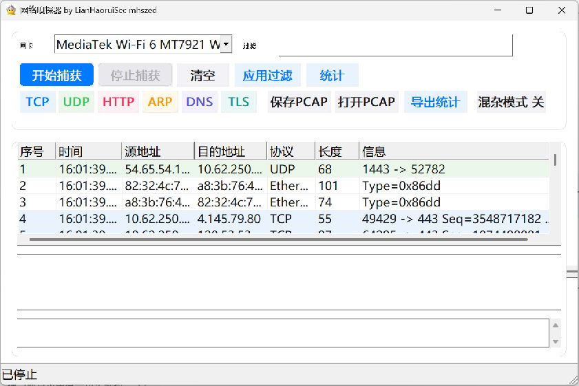

# 网络嗅探器 by LianHaoruiSec mhszed

一个面向 Windows 的现代化网络嗅探器，使用 C++17 和 Win32 API 开发，基于 Npcap/WinPcap 捕获数据包。界面采用 iOS/macOS 风格的卡片布局、圆角和 Mica/毛玻璃效果，支持高 DPI 显示。

项目用于学习和演示 WinPcap 嗅探器的完整开发过程，包括网卡枚举、BPF 过滤、多线程捕获、协议解析和可视化显示。



## 功能

- 枚举本机全部网卡，自动优先选择 MediaTek Wi-Fi 6 网卡
- 混杂模式捕获，支持开始、停止和清空
- BPF 过滤，支持协议、端口和地址组合表达式
- 捕获线程与界面线程分离，抓包时界面保持响应
- Ethernet、ARP、IPv4、TCP、UDP、ICMP、IGMP 协议解析
- HTTP、DNS、TLS、DHCP 应用层协议识别与摘要显示
- 数据包列表、树形详情和十六进制内容三栏视图
- 按协议着色、协议快捷过滤和协议统计
- 保存/打开 PCAP 文件，导出 CSV 统计
- Per-Monitor DPI Awareness，适配高分屏
- Mica/亚克力背景效果，低版本 Windows 自动回退
- 自定义应用图标和版本信息

## 环境要求

| 项目 | 要求 |
| --- | --- |
| 操作系统 | Windows 10/11 |
| 抓包运行库 | Npcap 1.x，安装时勾选 WinPcap API 兼容模式 |
| 编译器 | MinGW-w64 g++ 或 Visual Studio 2019+ |
| 构建工具 | CMake 3.16+（可选） |

Npcap 下载地址：<https://npcap.com/>

程序运行时会动态加载 `wpcap.dll`，优先查找 `C:\Windows\System32\Npcap`，因此不需要在编译时链接 Npcap SDK。

## 构建

### 方式一：MinGW-w64 脚本

确保 `g++`、`windres` 已加入 `PATH`，在仓库根目录执行：

```bat
scripts\build.bat
```

生成文件：`build\CppModernWinPcapSniffer.exe`

### 方式二：CMake

需要先安装 CMake 3.16+ 和 Ninja：

```bat
cmake -S . -B build -G Ninja
cmake --build build
```

如果仓库路径包含空格或中文，建议使用 Ninja；`MinGW Makefiles` 生成器对包含空格的路径支持较差。

使用 Visual Studio 时：

```bat
cmake -S . -B build -G "Visual Studio 17 2022"
cmake --build build --config Release
```

## 使用

1. 启动程序，选择要监听的网卡。
2. 在“过滤”输入框中填写 BPF 表达式，留空表示捕获全部流量。
3. 点击“开始捕获”，程序进入混杂模式并开始接收数据包。
4. 点击数据包列表中的任意一行，下方显示协议字段和十六进制内容。
5. 点击“统计”查看协议分布，或使用“保存PCAP”“导出统计”保存结果。

常用过滤表达式：

| 目的 | 表达式 |
| --- | --- |
| 仅 TCP | `tcp` |
| 仅 UDP | `udp` |
| 指定主机 | `host 192.168.1.10` |
| 指定端口 | `tcp port 80` |
| DNS 流量 | `udp port 53 or tcp port 53` |
| HTTPS 流量 | `tcp port 443` |
| ARP 广播 | `arp` |

## 项目结构

```text
.
├── .gitattributes
├── .gitignore
├── CMakeLists.txt
├── LICENSE
├── README.md
├── docs/
│   └── screenshot.jpg
├── resources/
│   ├── app.ico
│   └── app.rc
├── scripts/
│   └── build.bat
├── src/
│   └── CppModernWinPcapSniffer.cpp
└── build/                    # 本地构建输出，不提交
```

- `src/`：程序源码
- `resources/`：图标和 Windows 资源脚本
- `scripts/`：本地构建脚本
- `docs/`：文档和界面截图
- `build/`：构建输出目录，不纳入版本控制

## 协议支持

| 协议 | 解析内容 |
| --- | --- |
| Ethernet | 源/目的 MAC、EtherType |
| ARP | 操作码、发送方/目标 MAC 与 IP |
| IPv4 | 版本、首部长度、TTL、协议号、源/目的 IP |
| TCP | 端口、序号、确认号、标志位、载荷长度 |
| UDP | 端口、长度、载荷长度 |
| ICMP | 类型、代码、标识、序号 |
| IGMP | 类型、最大响应时间、组地址 |
| HTTP | 请求方法、Host、响应状态 |
| DNS | 查询名、查询类型、响应码 |
| TLS | 记录类型、版本、握手类型 |
| DHCP | 消息类型、客户端 MAC |

## 已知限制

- 不进行 TCP 流重组，HTTP 只做明文摘要识别。
- TLS 仅解析记录层和握手类型，不解析加密内容。
- 无线网卡能捕获的流量取决于驱动、信道和当前连接状态。
- 列表最多保留最近 5000 个数据包，避免长时间运行占用过多内存。

## 安全声明

本工具仅用于课程实验、授权测试和自有网络排障。请勿在未授权的网络中抓取他人通信数据。使用本工具产生的一切后果由使用者自行承担。

## 作者

LianHaoruiSec mhszed

## 许可证

本项目采用 MIT License，详见 [LICENSE](LICENSE)。
