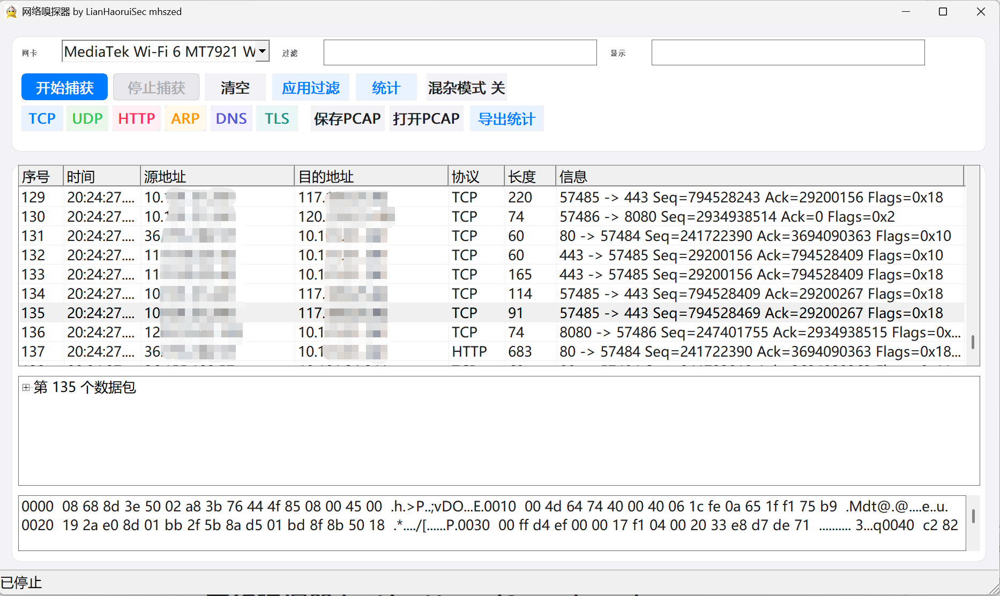

<div align="center">

# CppModernWinPcapSniffer

**一个使用 C++17 与 Win32 API 编写的现代化 Windows 网络嗅探器**

[](#环境要求)
[](#构建)
[](#技术实现)
[](https://npcap.com/)
[](LICENSE)

基于 Npcap/WinPcap 的实时抓包、BPF 过滤、协议解析与 PCAP 分析工具。

</div>

## 界面预览



界面集成了网卡选择、BPF 抓包过滤、显示过滤、协议快捷筛选、数据包列表、协议详情和十六进制查看。上图展示了程序捕获 TCP/HTTP 流量并查看指定数据包内容的典型运行状态。

## 项目简介

CppModernWinPcapSniffer 是一个面向 Windows 10/11 的学习型网络分析工具。项目使用原生 Win32 API 构建界面，不依赖 MFC 或第三方 UI 框架，并通过运行时动态加载 `wpcap.dll` 接入 Npcap，因此编译时无需安装 Npcap SDK。

它适合用于：

- 学习 WinPcap/Npcap 网卡枚举、BPF 过滤和多线程抓包
- 观察 TCP、UDP、DNS、HTTP、TLS 等协议的报文结构
- 查看 TLS ClientHello 中明文传输的 SNI 域名
- 将捕获结果保存为标准 PCAP 文件，继续使用 Wireshark 分析
- 学习 Win32 自定义绘制、高 DPI 和虚拟列表的实现方式

## 核心特性

| 功能 | 说明 |
| --- | --- |
| 实时抓包 | 枚举本机全部网卡，支持开始、停止、清空和混杂模式切换 |
| 双重过滤 | 独立的 Npcap BPF 抓包过滤与内存显示过滤 |
| 协议解析 | Ethernet、ARP、IPv4、ICMP、IGMP、TCP、UDP、HTTP、DNS、TLS、DHCP |
| TLS SNI | 从 ClientHello 中提取 SNI 域名，并识别真实 TLS 版本与握手类型 |
| 三栏详情 | 数据包列表、协议摘要树、完整十六进制内容联动查看 |
| 大列表性能 | 所有者绘制虚拟列表，界面只保留最近 5000 个数据包 |
| 文件互操作 | 保存/打开经典 PCAP，导出协议及端点统计为 CSV |
| 现代界面 | iOS/macOS 风格卡片、协议着色、Mica/亚克力回退和高 DPI 支持 |

## 环境要求

| 项目 | 要求 |
| --- | --- |
| 操作系统 | Windows 10/11 64 位 |
| 抓包运行库 | [Npcap 1.x](https://npcap.com/)，安装时选择 WinPcap API 兼容模式 |
| MinGW 工具链 | MinGW-w64 `g++`、`windres` |
| MSVC 工具链 | Visual Studio 2019/2022（安装“使用 C++ 的桌面开发”） |
| CMake | CMake 3.16+（使用 CMake 构建时需要） |

> 抓包和网卡枚举通常需要管理员权限。程序通过 `LoadLibraryW` 动态加载 `wpcap.dll`，优先从 `C:\Windows\System32\Npcap` 查找。

## 快速开始

### 1. 安装 Npcap

安装 Npcap 时请勾选 **Install Npcap in WinPcap API-compatible Mode**。如果 Windows 11 版本较新，建议使用 Npcap 官方提供的最新版本。

### 2. 克隆项目

```powershell
git clone <your-repository-url>
cd CppModernWinPcapSniffer
```

### 3. 构建

#### MinGW-w64

确认 `g++` 和 `windres` 已加入 `PATH`，然后在项目根目录运行：

```bat
scripts\build.bat
```

生成文件：

```text
build\CppModernWinPcapSniffer.exe
```

#### Visual Studio 2022 + Ninja

在项目根目录运行：

```bat
build-msvc.bat
```

生成文件：

```text
build-msvc\CppModernWinPcapSniffer.exe
```

`build-msvc.bat` 默认从 `D:\Program Files\Microsoft Visual Studio\2022\Community` 加载工具链。如果 Visual Studio 安装在其他位置，请修改脚本开头的 `VS` 路径。

> 源码使用无 BOM 的 UTF-8 编码，MSVC 构建必须启用 `/utf-8`，否则可能出现中文常量换行或语法错误。现有脚本已包含该选项。

#### CMake

MinGW + Ninja：

```powershell
cmake -S . -B build -G Ninja
cmake --build build
```

Visual Studio 生成器：

```powershell
cmake -S . -B build-msvc -G "Visual Studio 17 2022" -A x64
cmake --build build-msvc --config Release
```

如果项目路径包含空格，建议使用 Ninja，避免部分 Makefile 生成器对路径处理不佳。

### 4. 运行

双击生成的 EXE，或从终端运行：

```powershell
.\build\CppModernWinPcapSniffer.exe
```

## 使用流程

1. 在顶部“网卡”下拉框中选择实际承载流量的 Wi-Fi 或有线网卡。
2. 在“过滤”输入框填写 BPF 表达式，留空表示捕获全部流量。
3. 点击“开始捕获”，访问网络或执行待分析的测试业务。
4. 在“显示”输入框填写筛选条件并按回车，只筛选已经捕获的数据包。
5. 单击列表中的任意一行，查看协议摘要和十六进制内容。
6. 使用“保存 PCAP”或“导出统计”保存分析结果。

> 如果列表没有实际流量，请先确认没有选中 `WAN Miniport`、`Loopback` 等虚拟或无流量网卡。

## 两种过滤器

| 对比项 | 抓包过滤（BPF） | 显示过滤 |
| --- | --- | --- |
| 输入位置 | 顶部“过滤” | 顶部“显示” |
| 作用 | 决定哪些包会被捕获 | 决定哪些已捕获的包会被显示 |
| 生效方式 | 点击“开始捕获”或“应用过滤” | 按回车立即生效 |
| 被筛掉的包 | 不会进入程序 | 已经存在于内存列表中 |
| 能否恢复 | 修改表达式后重新开始捕获 | 清空表达式后立即恢复显示 |

典型组合：

```text
抓包过滤：tcp port 443
显示过滤：baidu
```

### BPF 抓包过滤示例

```text
ip
tcp
udp
arp
tcp port 80
udp port 53
host 192.168.1.10
net 192.168.1.0/24
tcp portrange 8000-9000
not host 192.168.1.10
tcp port 443 and host 183.2.172.177
```

常用协议快捷按钮会直接填入 BPF 表达式：

| 按钮 | 表达式 |
| --- | --- |
| TCP | `tcp` |
| UDP | `udp` |
| HTTP | `tcp port 80 or tcp port 8080 or tcp port 8000 or tcp port 8888` |
| ARP | `arp` |
| DNS | `udp port 53 or tcp port 53` |
| TLS | `tcp port 443 or tcp port 8443` |

域名会在应用 BPF 时解析为 IP。如果域名的 DNS 记录发生变化，需要重新开始捕获才能使用新地址。

### 显示过滤语法

显示过滤仅作用于已经捕获的数据。多个条件使用空格分隔，表示逻辑 AND。

| 写法 | 匹配对象 | 示例 |
| --- | --- | --- |
| `ip.src==值` | 源地址 | `ip.src==192.168.1.10` |
| `ip.dst==值` | 目的地址 | `ip.dst==8.8.8.8` |
| `ip.addr==值` | 源地址或目的地址 | `ip.addr==8.8.8.8` |
| `proto==值` | 协议列 | `proto==TLS` |
| 裸关键字 | 地址、协议和信息列 | `baidu` |

所有匹配均不区分大小写，并采用子串包含规则。例如 `ip.src==192.168` 可以匹配 `192.168.1.10`。

```text
proto==TLS ip.src==192.168.1.10
```

当前显示过滤不支持 `or`、`!=`、括号和数值比较；端口号可以作为普通关键字搜索。

## TLS SNI 说明

HTTPS 内容经过 TLS 加密，但连接建立时的 ClientHello 通常会明文携带 SNI 服务器名。程序可以显示类似信息：

```text
192.168.1.10 -> 183.2.172.177 | 46697 -> 443 | ClientHello SNI=www.baidu.com TLS1.3
```

SNI 通常只出现在连接的第一个包中。如果该包已被 5000 行滚动窗口淘汰，就无法再从当前列表中恢复。

> 本工具不解析 TLS 加密内容，也无法直接查看 HTTPS 请求 URL、Cookie 或表单数据。

## 项目结构

```text
CppModernWinPcapSniffer/
├── .gitattributes                 # Git 文本编码与换行规则
├── .gitignore                     # 构建产物和编辑器文件忽略规则
├── CMakeLists.txt                 # CMake 构建配置
├── LICENSE                        # MIT 许可证
├── README.md                      # 项目说明
├── build-msvc.bat                 # Visual Studio 2022 + Ninja 构建脚本
├── docs/
│   └── images/
│       └── screenshot.png         # 最新程序运行截图
├── resources/
│   ├── app.ico                    # 应用图标
│   └── app.rc                     # Windows 资源与版本信息
├── scripts/
│   └── build.bat                  # MinGW-w64 构建脚本
└── src/
    └── CppModernWinPcapSniffer.cpp
```

`build/`、`build-msvc/` 和中间文件不会提交到仓库。可通过 GitHub Releases 单独发布编译好的 EXE。

## 技术实现

- 使用原生 Win32 控件和所有者绘制完成现代化界面
- 抓包线程与 UI 线程分离，通过 Windows 消息传递捕获结果
- 自行声明 Npcap 所需的最小函数接口，运行时动态链接 `wpcap.dll`
- 数据包列表采用 `LVS_OWNERDATA` 虚拟列表，限制内存中的历史记录数量
- 使用 Per-Monitor V2 DPI Awareness，并按当前 DPI 重新布局控件
- 优先启用 DwmSetWindowAttribute 的 Mica/亚克力效果，不支持时回退到普通背景
- 同时维护协议计数和端点计数，可导出为 CSV 进行二次分析

## 协议支持

| 协议 | 已解析内容 |
| --- | --- |
| Ethernet | 源/目的 MAC、EtherType |
| ARP | 操作码、发送方/目标 MAC 与 IP |
| IPv4 | 版本、首部长度、TTL、协议号、源/目的 IP |
| TCP | 端口、序号、确认号、标志位、载荷长度 |
| UDP | 端口、长度、载荷长度 |
| ICMP | 类型、代码、标识、序号 |
| IGMP | 类型、最大响应时间、组地址 |
| HTTP | 请求方法、Host、响应状态 |
| DNS | 查询名、查询类型、响应码 |
| TLS | 记录类型、版本、握手类型、SNI |
| DHCP | 消息类型、客户端 MAC |

## 已知限制

- 不进行 TCP 流重组，被拆分到多个数据包的 HTTP 报文会显示为多行。
- TLS 仅解析记录层、握手和 SNI，不解析加密应用数据。
- 列表最多保留最近 5000 个数据包，被淘汰的数据包无法再次查看。
- 无线网卡可捕获的流量受驱动、信道、连接状态和系统策略影响，Wi-Fi 上的混杂模式效果有限。
- 显示过滤只支持 AND 组合和子串匹配。
- 当前仅支持打开经典 PCAP 文件，打开 `.pcapng` 时会提示暂不支持。

## 常见问题

### 开始捕获后没有数据包

请选择实际存在流量的 Wi-Fi 或有线网卡。`WAN Miniport`、`Loopback` 等接口可能不会出现可用于分析的常规流量。

### 输入显示过滤后列表为空

显示过滤只搜索已经捕获的数据。请确认匹配关键字，并确认目标数据包仍在最近 5000 个记录中。

### 为什么看不到 HTTPS 请求内容

被动抓包只能看到 TLS 密文。程序可显示 SNI、TLS 版本、握手类型和密文长度，但不能直接还原加密请求。

### 为什么编译时找不到 Npcap SDK

本项目不需要 Npcap SDK。请确保运行环境中已安装 Npcap，并勾选 WinPcap API 兼容模式。

## 安全与合规

本工具仅用于课程实验、授权测试和自有网络排障。请勿在未授权的网络中抓取或分析他人通信数据。使用本工具产生的一切后果由使用者自行承担。

## 作者

**LianHaoruiSec mhszed**

## 许可证

本项目采用 [MIT License](LICENSE)。
